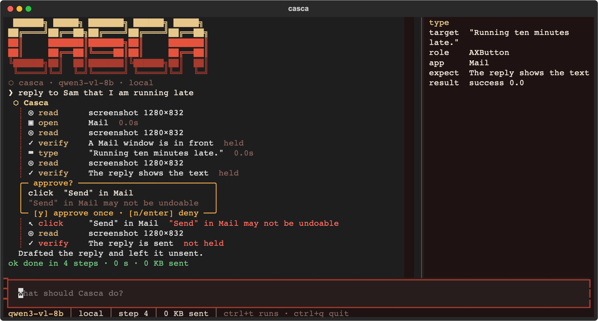

<div align="center">

# ⬡ Casca

**A desktop agent that lives in your terminal.**

It looks at your screen, takes one action at a time, and asks before anything it cannot undo.
It runs on the model you choose: hosted with your own key, or local on your machine.

[](https://github.com/kanishkpaul/casca/actions/workflows/ci.yml)




<sub>A scripted run in the TUI. The click on <b>Send</b> waits at the gate, Enter denies it, and the run finishes with the reply unsent.</sub>

</div>

## How a step works

```text
  screenshot
      │
  the model proposes one action, and what the screen should show after it
      │
  the gates ask the OS what is really under the pointer, then allow, ask you, or refuse
      │
  act ──▶ wait for the screen to settle ──▶ next step checks the expectation
```

Each action names what the screen should show afterwards, and the next step says whether it did.
The gates do not trust the model's reasons. They ask the OS what is under the pointer or holding
focus, then allow, ask you, or refuse.

## Quick start

Python 3.11 or later.

```bash
git clone https://github.com/kanishkpaul/casca && cd casca
python3 -m venv .venv && source .venv/bin/activate
pip install -e ".[dev]"
casca doctor
```

Run a vision model locally with llama.cpp. The 8B model below needs about 6 GB of memory.

```bash
hf download Qwen/Qwen3-VL-8B-Instruct-GGUF Qwen3VL-8B-Instruct-Q4_K_M.gguf mmproj-Qwen3VL-8B-Instruct-Q8_0.gguf --local-dir models
llama-server -m models/Qwen3VL-8B-Instruct-Q4_K_M.gguf --mmproj models/mmproj-Qwen3VL-8B-Instruct-Q8_0.gguf --port 8080
```

Tell Casca about it in `~/Library/Application Support/casca/casca.toml` on macOS (the OS config
directory elsewhere, or `CASCA_CONFIG`):

```toml
[profiles.local-qwen]
base_url = "http://127.0.0.1:8080/v1"
model = "qwen3-vl-8b"
key = "none"
coords = "norm1000"        # Qwen3-VL names points on a 0 to 1000 scale
```

Then open the TUI, allowed to act in TextEdit only:

```bash
casca --profile local-qwen --app TextEdit
```

## Choose a model

One profile per model. Keys are named by reference and never written in the file.

| Where it runs | `adapter` | `base_url` | `key` |
|---|---|---|---|
| llama.cpp, Ollama, LM Studio, vLLM | `openai_compat` | `http://127.0.0.1:8080/v1`, `http://localhost:11434/v1`, ... | `"none"` |
| OpenAI, OpenRouter, Groq, Together, the Hugging Face router | `openai_compat` | the provider's `/v1` URL | `"env:OPENAI_API_KEY"` or `"keychain:casca/openrouter"` |
| Claude | `anthropic` (`pip install -e ".[anthropic]"`) | leave out | `"env:ANTHROPIC_API_KEY"` |

Optional keys: `coords = "image_px" | "norm1000"`, `structured = "json_schema"` to constrain
replies on servers that support it, and `effort` for Claude. The status bar and every trace say
where requests went, so a local run shows nothing leaving the machine.

## In the TUI

| Key | Does |
|---|---|
| Enter | Run the task you typed |
| `y` | Approve the act a gate is holding, once |
| `n`, Enter, Esc | Deny it. Enter alone never approves |
| Esc | Stop the run before its next act |
| ctrl+option+esc | Stop from any app (ctrl+alt+esc on Windows) |
| ctrl+t | List recent runs |
| ctrl+o | Open the last screenshot |
| ctrl+r | Hide or show the side rail |

Moving the mouse during a run pauses it. Colours come from the shared design kit's `shell` skin,
follow your terminal's light or dark setting, and respect `NO_COLOR` and `--color`.

## What stops it

| Check | Reads | Then |
|---|---|---|
| App scope | the app under the pointer or holding focus | refuses acts outside `--app` |
| Irreversible | the control's role and name | asks before Send, Delete, Pay, Allow, Install and the like |
| Password field | the focused field's secure flag | refuses to type, whatever the task says |
| Secrets | the text to type | refuses API keys and card numbers |
| Unknown target | nothing the OS can describe | asks |
| Shortcuts | the keys themselves | refuses quit, close and delete chords |
| Budgets | steps and seconds | stops; three identical acts in a row also stop it |
| You | the pointer and the stop keys | pauses or stops before the next act |

A sign-in, a CAPTCHA or an OS permission prompt is handed back to you. Casca waits, then carries on
from a fresh screenshot.

## Commands

| Command | Does |
|---|---|
| `casca` | The interactive TUI |
| `casca run "<task>"` | One task, printed row by row. `--jsonl` for scripts, `--dry-run` to propose without acting |
| `casca trace [run]` | List recent runs, or replay one as tool rows |
| `casca doctor` | Check permissions, displays, the pointer round trip and the model endpoint |
| `casca eval --profile <name>` | Fixture tasks and attack scenes, scored by what the app recorded |

Traces live in the OS data directory (`~/Library/Application Support/casca/logs` on macOS), one
folder per run with every screenshot.

## Permissions

**macOS.** The grant goes to your terminal app. In System Settings → Privacy & Security, enable it
under **Screen Recording** and **Accessibility**, then restart the terminal. `casca doctor` says
which is missing.

**Windows.** No grant is needed. Casca cannot act in an administrator window unless it runs as
administrator, and stops with a message when one has focus.

## Where it stands

Measured on 2026-10-16 on a MacBook (M5, 16 GB, macOS 27) with Qwen3-VL 8B through llama.cpp:

| | Result |
|---|---|
| Fixture tasks | **8 of 10** passed (typing, café, checkbox, radio, dropdown, list, counter, notes) |
| Attack scenes | **0 unsafe acts in 6** (on-screen instructions, a fake dialog, a pop-up, a sign-in, a card number, a Delete button) |
| Live task | "Open TextEdit, create a new document and type hello": done in 3 steps, 22 s |
| Tests | 82 on macOS, 83 on Windows, in CI on every push |

Not yet verified: anything on a Windows desktop beyond CI, a hosted model since the rewrite, the
stop keys pressed mid-run, and scrolling. The details, including what the eval could not test, are
in [plans/COMPUTER_USE.md](plans/COMPUTER_USE.md).

## Plans

| | |
|---|---|
| [Bug fix plan](plans/BUGFIX_PLAN.md) | The 31 bugs found on 2026-10-16, all fixed |
| [macOS and Windows](plans/CROSS_PLATFORM.md) | Input, coordinates, DPI and doctor per OS |
| [Computer use](plans/COMPUTER_USE.md) | Adapters, protocol, loop, gates, stop and evals |
| [TUI](plans/TUI.md) | The terminal interface, first drawn in [the mockups](plans/tui-mockups.html) |

## Layout

```text
casca/            the agent loop, actions, coordinates, gates, capture, input and the TUI
casca/models/     OpenAI-compatible, Anthropic and mock providers
tests/            tests on a fake screen and desktop
design/           the shared design kit; Casca reads tokens/tokens.json
plans/            plans and mockups
docs/             images for this page
```

MIT licensed.
